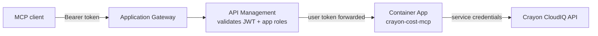

# Crayon Cost MCP Server

MCP server exposing Crayon CloudIQ cost and billing data as **31 tools**, over
Streamable HTTP using the latest MCP protocol revision (**2026-07-28**).

Callers are authorized with **Entra ID app roles**; the Crayon API is always
called with the server's own credentials.

---

## Architecture



The container **re-validates every token independently**. A gateway is not a
sufficient trust boundary: a bypassed or misrouted one must not become
unauthenticated access to cost data.

---

## Configuration

### Crayon API credentials — always required

These identify the server to Crayon CloudIQ and are needed in **every** auth
mode. The caller never supplies them.

| Variable | Description |
| --- | --- |
| `CRAYON_CLIENT_ID` | OAuth client ID |
| `CRAYON_CLIENT_SECRET` | OAuth client secret |
| `CRAYON_USERNAME` | Delegated username |
| `CRAYON_PASSWORD` | Delegated password |
| `CRAYON_API_BASE_URL` | Defaults to `https://api.crayon.com/api/v1` (HTTPS required) |

Obtain these from your Crayon account team. In Azure Container Apps they must be
**container secrets**, never plain environment values.

### Entra ID app roles

Two app roles are defined on the **API app registration**, surfaced in the
token's `roles` claim:

| App role | Grants | Applied to |
| --- | --- | --- |
| `user.read` | All read/analytics tools | 30 tools (the default policy) |
| `user.write` | Mutating tools | `update_subscription_tags` |

**`user.write` does not imply `user.read`** — grant both to an editor. Tools with
no explicit policy default to `user.read`.

| Variable | Required | Default |
| --- | --- | --- |
| `AUTH_MODE` | yes (in Azure: `entra`) | inferred from `ENTRA_*` |
| `ENTRA_TENANT_ID` | yes | — |
| `ENTRA_AUDIENCES` | yes — **space-separated list** | — |
| `ENTRA_READ_ROLE` / `ENTRA_WRITE_ROLE` | optional | `user.read` / `user.write` |
| `ENTRA_REQUIRED_SCOPE` | optional | — |
| `ENTRA_JWKS_URI` | optional (private endpoints / tests) | derived |

**`ENTRA_AUDIENCES` must list every accepted `aud` form.** Entra stamps `aud`
with the identifier URI the client used as its OAuth `resource` (RFC 8707), so
both the public MCP URL and the `api://` form must be listed — and each must
exist on the app registration:

```
ENTRA_AUDIENCES="api://<api-client-id> https://mcp.example.com/crayon-mcp"
```

Omitting the public URL 401s every MCP client (`AADSTS500011` client-side,
`invalid audience` server-side); omitting the `api://` form 401s service callers.
`ENTRA_AUDIENCE` (singular) is still read as a single-value alias. Role names must
match the app registration manifest.

### Access scope

| Variable | Default | Purpose |
| --- | --- | --- |
| `ALLOWED_ORGANIZATIONS` | *(empty)* | Comma-separated organization IDs callers may read |
| `ALLOWED_WRITE_ORGANIZATIONS` | *(empty)* | Organizations that may be mutated (empty = all readable ones) |
| `ALLOW_ALL_ORGANIZATIONS` | `false` | Explicit opt-in to an unrestricted deployment |
| `TRUST_PROXY` | `1` | Reverse-proxy hops trusted when resolving the client IP |

**`ALLOWED_ORGANIZATIONS` fails closed.** Empty denies every organization-scoped
call and is a startup **error** under `NODE_ENV=production` — a missing variable
must not be the difference between one customer and every customer.

See `.env.example` for rate limits, timeouts and circuit-breaker thresholds.

---

## Authorization

Two independent checks, both required:

1. **Transport** — validates the token (signature, issuer, audience, expiry) and
   publishes the app roles. Every method, including `initialize`, requires a
   token: nothing is served anonymously, and a missing credential gets `401` with
   a `WWW-Authenticate` challenge.
2. **Tool dispatch** — one gate per invocation, run *before* validation and
   before any Crayon call: app role → organization allowlist →
   write-organization allowlist. Denials return a normal MCP tool error.

- **Scoping is not optional.** Tools with an optional `organizationId`
  (`get_subscriptions`, `get_customer_tenants`, `get_aws_accounts`,
  `list_all_subscriptions_with_tags`) are refused when it is omitted, and
  `get_organizations` is filtered to the allowlist — otherwise leaving out an
  argument would aggregate every organization the service credential can see.
- **`GET /metrics`** requires the read app role; **`GET /health`** is the only
  unauthenticated endpoint (probes need it).
- **Adding a mutating tool?** Register it in `TOOL_POLICIES` in
  `src/middleware/auth.ts`. The default is read-only, so an unreviewed tool
  cannot silently become write-capable.

### Gateway edge gate

The per-API `validate-jwt` policy requires **any one** of the two roles, because
this server has a single surface — it is an *app-access* gate, not an operation
gate:

```hcl
required_scopes = ["user.read", "user.write"]   # match="any" → ORed
```

> Do **not** narrow this to `["user.read"]`: a caller holding only `user.write`
> would be refused at the gateway and could never reach the tool that role
> exists for.

The container enforces the precise per-tool role on top.

---

## Deployment (Azure Container Apps)

| Property | Value |
| --- | --- |
| Port | `3003` on `0.0.0.0` — set `ingress.targetPort` to match |
| User | non-root `nodejs` (uid/gid 1001) |
| Protocols | `2026-07-28` native, with the SDK's stateless fallback for 2025-era clients |
| Logs | **stderr** only |
| Shutdown | handles `SIGTERM` |

**Probes** — ACA ignores the Dockerfile `HEALTHCHECK`, so configure `/health` on
the container app: startup (delay 5s, period 5s, threshold 12), liveness (30s),
readiness (10s).

**Endpoints** — `POST /mcp` (authenticated), `GET /health` (unauthenticated),
`GET /metrics` (authenticated + read role).

```bash
docker build -t <registry>/crayon-cost-mcp:<tag> .
```

---

## Development

```bash
npm install
npm run build          # compile TypeScript
npm run test:smoke     # HTTP, auth-gate, Entra JWT and startup-guard checks
npm run test:tools     # drives all 31 tools against a mock Crayon API
```

Both suites run without a Crayon account or Entra tenant: the tool suite serves a
mock Crayon API and validates every call against the Crayon OpenAPI spec.

---

## Security notes

Never commit `.env` or Crayon credentials; report vulnerabilities privately (see
[Security advisories](https://docs.github.com/code-security/security-advisories)).
Known limitations:

- **Rate limiting is per-process** — N replicas means N × `RATE_LIMIT_MAX_REQUESTS`.
  Enforce a real limit at the gateway if that matters.
- **The organization allowlist is global, not per-caller** — everyone with
  `user.read` sees the same organizations. Per-caller scoping needs the mapping in
  the token (per-organization app roles or a group claim).
- **Cost data is never cached**, deliberately: a cache key would have to carry the
  caller's identity and every query parameter to avoid cross-caller leakage.

---

## Support

- Crayon CloudIQ API: <https://apidocs.crayon.com/>
- MCP protocol: <https://modelcontextprotocol.io/>
